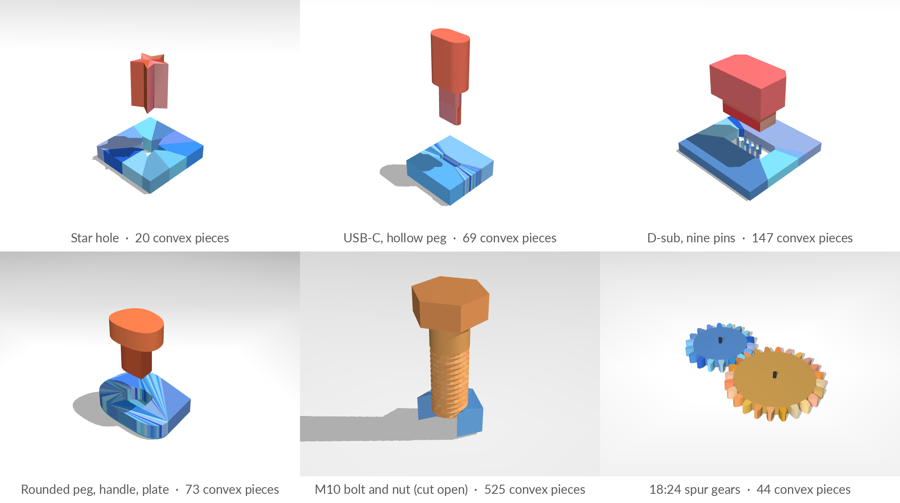

# mjfit

**Exact convex collision geometry for MuJoCo assemblies:** pegs and holes from any
outline, threads, and gears.

[Paper](https://arxiv.org/abs/2610.23849) ·
[Project page](https://younghyopark.me/blind-proprioceptive-assembly/)



MuJoCo collides only convex shapes, and a hole is concave. Approximate convex
decomposition (CoACD, V-HACD) fills in the very clearance an assembly task depends on,
and signed-distance collision is slow and misses contacts. mjfit builds each part from
convex prisms whose union is the exact part. The plate around a hole is cut into convex
wedges, the peg is the hole offset inward by the clearance, and thread and gear teeth
are swept from convex profiles. Every peg edge sits exactly one clearance from its hole
edge, and MuJoCo collides every piece natively.

- **Exact.** Circles and arcs become polygons that circumscribe them, so a round hole is
  never smaller than drawn. Each polygon strays from its curve by at most `max_error`,
  which should stay well below the clearance.
- **Fast.** A peg and its hole are a few dozen convex pieces. On CPU they step an order of
  magnitude faster than MuJoCo's mesh SDF at equal or better accuracy
  ([benchmark](#benchmark)).
- **Procedural.** Outlines, islands, and dimensions are parameters, so one training run
  can hold thousands of different assemblies ([sampling](#many-assemblies-for-training)).

## Install

```bash
pip install git+https://github.com/younghyopark/mjfit
```

mjfit needs Python 3.10 or newer and MuJoCo 3.3 or newer. To work on it, clone the
repository and run `pip install -e ".[test]"`.

## Quick start

From the command line:

```bash
mjfit peg --shape star -o star.xml           # a star-shaped peg and its hole
mjfit peg --config usb_c -o usb_c.xml        # a bundled config: USB-C with its tongue
mjfit thread --config m10 -o m10.xml         # an M10 bolt engaged in its nut
mjfit gear --teeth 18 24 -o gears.xml        # a meshing pair of spur gears
mjfit gear --teeth 18 54 --internal -o ring.xml  # a pinion inside a ring gear
python -m mujoco.viewer --mjcf=usb_c.xml
```

Add `--view` to open the result in MuJoCo's viewer, and `mjfit configs` lists the
bundled configs. Every option of the Python functions below is also a flag
(`mjfit peg --help`).

From Python, each generator returns an MJCF string:

```python
import mujoco
import mjfit
from mjfit import shapes

# A USB-A receptacle: a 12 x 4.5 mm opening with a tongue standing in it.
# The plug becomes a hollow shell with a pocket around the tongue.
xml = mjfit.peg(
    hole=shapes.rect(0.012, 0.0045),
    islands=[shapes.rect(0.008, 0.0015, center=(0, 0.001))],
    clearance=1e-4, plate_thickness=0.005, peg_length=0.012,
)
model = mujoco.MjModel.from_xml_string(xml)

bolt_and_nut = mjfit.thread(major_diameter=0.010, pitch=0.0015, clearance=1e-4)
gears = mjfit.gear(teeth=(18, 24), module=0.003)
ring = mjfit.gear(teeth=(18, 54), internal=True)
```

Lengths are in meters, masses in kilograms, and angles in degrees.

## What it builds

**Pegs and holes** ([docs](docs/pegs.md)). Give the outline of either the hole or the
peg; the other is its exact offset by `clearance`. An outline is an array of vertices or
a shape from `mjfit.shapes`: `circle`, `rect`, `stadium`, `trapezoid`, `ngon`, `star`,
`polygon`, `bezier` (rounded corners), or `csv`. Then add what the part needs:

| To add | Use |
| --- | --- |
| Material standing in the hole, such as a USB tongue or connector pins; the peg becomes a hollow shell | `islands` |
| A wider grip section above the peg | `handle_height`, and optionally a `handle` outline |
| A convex outer plate that keeps a rim around the hole and handle | `plate`, `min_rim` |
| A closed hole | `bottom_thickness` |
| A fixed total mass for the peg | `peg_mass` |

**Threads** ([docs](docs/threads.md)). A bolt and its nut, swept from ISO metric,
trapezoidal, ACME, square, buttress, round-wire, or your own tooth profiles, including
hooked and undercut teeth. They can be single- or multi-start and left- or right-handed.
The wedges only ever lose material to the helix's discretization, so they never
interfere.

**Gears** ([docs](docs/gears.md)). A spur gear, a ring gear, or a meshing pair with
involute teeth, on hinges, with an optional motor. Each external tooth is one convex
prism; a ring is convex wedges out to its rim. A pair meshes at its exact tooth ratio,
and an internal pair turns both gears the same way.

## Many assemblies for training

`mjfit.sample_pegs` draws random assemblies as plain config dicts, which are valid YAML
and ready for `mjfit.build`:

```python
configs = mjfit.sample_pegs(1000, seed=0, family='convex')
xmls = [mjfit.build(cfg) for cfg in configs]
```

There are two families ([docs](docs/sampling.md)):

- `convex`: random convex outlines with three to ten vertices and Bezier-rounded
  corners, optional handles, and convex plates. Its defaults follow the peg family the
  paper's policies train on.
- `primitive`: circles, rectangles, stadiums, polygons, and stars, with up to three
  islands standing in the hole.

Each option is a fixed value or a `(low, high)` range. Sample `i` of a seed is the same
however many you draw. `mjfit.grid` lays several assemblies out in one scene and renames
each one's bodies, geoms, and meshes so they never clash:

```python
parts = [mjfit.build(cfg, standalone=False) for cfg in configs[:25]]
model = mjfit.grid(parts, spacing=0.2).compile()     # bodies p0_plate, p0_peg, p1_plate, ...
```


## Configs

A config file holds a generator's keyword arguments in YAML, plus its `kind`:

```yaml
kind: peg
hole: {type: stadium, width: 0.00834, height: 0.00256, max_error: 1.0e-5}
islands:
  - {type: stadium, width: 0.0065, height: 0.0007, max_error: 1.0e-5}
clearance: 5.0e-5
plate_thickness: 0.0062
peg_length: 0.012
```

`mjfit.build('my_part.yaml')` or `mjfit peg --config my_part.yaml` builds it. A
misspelled key is an error that suggests the right one. These configs ship with the
package:

| Kind | Configs |
| --- | --- |
| peg | `circle`, `star`, `usb_a`, `usb_c`, `hdmi`, `rj45`, `db9`, `xlr3`, `rounded_convex` |
| thread | `m10`, `m6`, `furniture_bench_leg` |
| gear | `spur_pair`, `reduction_12_36`, `fine_pitch_32_48`, `single_24`, `internal_18_54` |

## Using the models in your own scene

- **Contact.** Every generated geom belongs to the default class `mjfit`, which sets
  stiff contacts (`solref` 2 ms). Simulate with a time step of 1 ms or less.
- **Composition.** By default each file runs on its own, with a floor, a light, and
  solver options. `standalone=False` (`--no-standalone`) emits only the parts and their
  default class, ready to `<include>` or to attach with `mujoco.MjSpec.attach`.
- **Names and frames.** The bodies are `plate` and `peg`, `bolt` and `nut`, or `gear_a`
  and `gear_b`. The plate's bottom rests on z = 0. Each generator's docstring gives its
  frames.
- **Mesh files.** Meshes are inline vertex lists by default. Pass `mesh_dir`
  (`--export-meshes`) to write them as OBJ files instead, as USD converters need.
- **Gears and the solver.** Hinged gears give MuJoCo's default Newton solver almost no
  contact regularization, so the gear files use PGS. Keep PGS for hinged gears in your
  own scenes; a gear on a free joint, held by a gripper, works with either solver.

## Benchmark

[`benchmark/`](benchmark/) compares mjfit with CoACD, V-HACD, and MuJoCo's mesh SDF on a
16 mm round or square peg with clearances down to 20 µm. It measures the settled error
against analytic ground truth and the time per step, on CPU and on GPU with MuJoCo Warp.
Approximate decomposition leaves wall material in the hole. Mesh SDF misses contacts
and rounds the rim. A centered peg dropped onto each method's default plate falls
through mjfit's but stops on the rim or jams on the others. The raw results and the
commands that reproduce every number are in the benchmark's
[README](benchmark/README.md).


## Citation

mjfit was built for the paper below. If you use it, please cite:

```bibtex
@misc{bronars2026blindpreciseassemblyproprioceptive,
      title={Blind Precise Assembly: Proprioceptive Sim-to-Real Peg-in-Hole for Diverse Parts},
      author={Antonia Bronars and Younghyo Park and Kushal Kedia and Pulkit Agrawal},
      year={2026},
      eprint={2610.23849},
      archivePrefix={arXiv},
      primaryClass={cs.RO},
      url={https://arxiv.org/abs/2610.23849},
}
```

## License

MIT. See [LICENSE](LICENSE).
